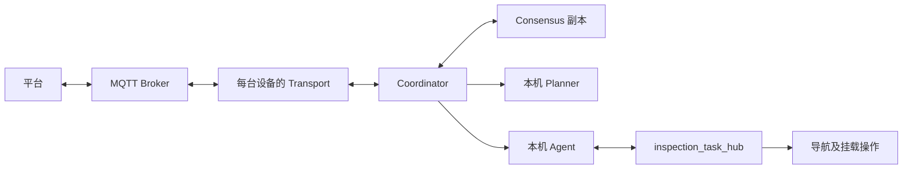

# Swarm 多机任务协调

`swarm_*` 是设备端运行的全分布式协同开发版本（0.1）。每台设备保存任务副本，由具有固定多数派权限的 Leader 协调规划和执行。云端保留平台、MQTT Broker 和存储，运行任务时不需要云端调度 ROS 节点。

当前交付用于本地模拟和接口开发。平台实际前后端、5G 网络、真实 MinIO 条件写入以及有人值守的运动验收尚未进行，不能直接替换现有演示部署。验证记录和复现命令见 [TEST_LOG.md](TEST_LOG.md)，设计依据见 [架构方案](../多机协同全分布式架构方案_部门评审稿.md)。

## 模块

| 包 | 职责 |
| --- | --- |
| [swarm_protocol](../swarm_protocol/README.md) | JSON 协议、校验、摘要、持久化和进程锁 |
| [swarm_consensus](../swarm_consensus/README.md) | 固定成员 Raft、唯一 Leader、日志提交、读屏障、启动会话与隔离 |
| [swarm_mission_planner](../swarm_mission_planner/README.md) | 独立地图搜索、能力分配和路线依赖 |
| [swarm_execution_agent](../swarm_execution_agent/README.md) | 本机 YAML、TaskHub、累计导航证据、结果 outbox 和执行授权 |
| [swarm_mqtt_transport](../swarm_mqtt_transport/README.md) | MQTT 消息转发；控制和图片使用独立连接 |
| swarm_mission_coordinator | 提交驱动的任务状态机、重分配、平台事件、图片与报告 |

六个新包不导入、链接或调用原四个协同包。旧包保留用于半分布式演示。TaskHub 和接口继续使用 `inspection_*`；Bringup 增加显式模式选择。

`swarm_mission_coordinator` 是整套系统的启动与文档入口，因而保存总览、协议、配置和跨包集成记录。它在**每台设备**运行，不是固定中央主机；当前 Leader 才能提交决策。各包自己的 README／TEST_LOG 说明本包职责，并链接到统一集成记录。

目录按职责组织：`launch/`、`config/` 负责启动，`examples/` 保存版本化报告和平台消息样例，`test/` 保存测试，内层同名 Python 目录保存运行代码。协调器内部 `model.py` 只应用已提交状态，`coordinator.py` 产生下一步提案，`node.py`／`api.py` 适配 ROS，`platform.py` 投影事件，`media.py` 管理图片，`reporting.py` 管理报告与后台任务，`storage_upload.py` 单独处理 S3 条件写入。



## 安装与构建

使用 ROS 2 Jazzy，从工作区根目录构建。需要系统依赖 `python3-paho-mqtt`、`python3-boto3`、`python3-yaml`、`python3-pil`、`python3-numpy` 和 `python3-scipy`；这些 Python 运行依赖不是 `colcon` 自动安装的依赖。

```bash
cd ~/colcon_ws/agibot_d1max_ws
source /opt/ros/jazzy/setup.bash
colcon build --packages-select inspection_interfaces swarm_protocol swarm_consensus \
  swarm_mission_planner swarm_execution_agent swarm_mqtt_transport \
  swarm_mission_coordinator --symlink-install
source install/setup.bash
```

设备已有 TaskHub 和 Bringup 时继续使用原工作区的对应包。运行新系列不需要安装原四个协同包。

## 启动配置

独立设备配置示例为 [device.example.yaml](config/device.example.yaml)。先复制为设备自己的文件，设置 `robot_id`、集群和 MQTT；`robot_ids` 不写在设备配置中。

```bash
ros2 launch swarm_mission_coordinator swarm_device.launch.py config:=/绝对路径/device.yaml
```

该入口启动五个新节点，不启动导航、TaskHub 或原协同节点。默认 `allow_motion: false`，TaskHub 前缀 `/swarm/mock`，Broker 为本机，平台主题为独立开发主题。仅把 `allow_motion` 改为 true 仍不足以连接真实 TaskHub；真实接口需显式配置 `task_hub_prefix: ''`。

Agent 检查本 ROS 域内的旧控制节点和重复服务提供者，存在冲突时拒绝发送控制。这个检查不是跨网络安全互锁；切换控制栈时仍须先停止原服务，确认设备已停止。

通过统一 Bringup 启动时：

```bash
ros2 launch inspection_bringup inspection_system.launch.py \
  cooperation_mode:=swarm swarm_config_path:=/绝对路径/device.yaml
```

也可在现有 `robot.yaml` 的 `system` 中增加：

```yaml
system:
  cooperation:
    mode: swarm
    config_path: /绝对路径/device.yaml
```

默认模式仍为 legacy。swarm 模式禁用旧 Agent／planner／选举及 Bridge 的旧协同转发；显式同时启用旧 Agent 会报错。Bringup 仍按原模块配置启动其余组件；本地测试使用独立新入口及模拟 TaskHub，不使用这条整机启动命令。

## 任务输入

平台在配置的 `<platform_prefix>/services` 发布 `task.execute`：

```json
{
  "bid": "demo-001",
  "tid": "request-001",
  "method": "task.execute",
  "data": {
    "round_epoch": 101,
    "robot_ids": ["X30-A", "CYVET-A", "CYVET-B"],
    "map_package": "/home/cat/Workspace/Maps/company2",
    "tasks": [
      {
        "id": "point-1",
        "location": {"frame_id": "map_000", "pos": [3.0, 4.0, 0.0]},
        "tasks": [{"method": "wait", "requirements": ["device"],
                   "params": {"timing": "after_arrival", "duration": 2}}]
      }
    ]
  }
}
```

`round_epoch` 为平台持久生成、按集群单调增加的正安全整数；与选举任期不同。名单中的全员都必须参与首次准备，不会静默缩小名单。位姿、服务、地图摘要和启动会话必须匹配。准备期限到达后明确失败；没有多数派时无法提交全局结论。

同轮同内容幂等，冲突内容拒绝。新 epoch 不覆盖活动执行；全新任务不要求先 reset。ID 大小写敏感，使用字母、数字、点、下划线和连字符。

`location.pos` 为本地图米坐标；可选 quaternion `orientation`，缺省使用 `yaw`（度）。每点 `tasks` 必填，纯导航使用空数组。挂载操作 `params` 直接保留为 TaskHub YAML 字段，能力由操作的 `requirements` 汇总，另包含基础 `device`。

`task.add` 携带当前轮次、同一名单、同一地图及新增点。未确认到达点和跳点参与事件重分配，不消耗最终补执行额度。重复点 ID 拒绝。

## 本机 ROS 接口

| 名称 | 类型 | 含义 |
| --- | --- | --- |
| `/swarm/mission/plan` | `inspection_interfaces/action/PlanMission` | 文件任务入口；文件不含 mission_id，Action 字段为准 |
| `/swarm/mission/replan` | 同上 | 当前轮新增点入口，文件只放新点，mission_id 与当前任务一致 |
| `/swarm/mission/stop`、`reset` | `std_srvs/srv/Trigger` | 请求本机停止，并把全局取消请求转发给 Leader |
| `/swarm/mission/state` | `std_msgs/msg/String` | 当前已提交任务摘要、Leader 和多数派状态 |
| `/swarm/agent/local_stop` | `std_srvs/srv/Trigger` | 仅请求本机停止，不宣称全局已取消 |

Action 返回 `planned` 表示计划和启动确认已经提交，不表示整轮执行完成。取消及 Trigger 成功表示请求已受理，全局停止仍需多数派和执行证据。少数派期间可以请求本机停止，不能伪造全局 CANCELLED。

本机文件输入会定向传递给本轮其他参与设备。各设备的地图必须预先部署在输入所指路径；本版本不负责地图下载。

## 执行和故障语义

业务状态集中在 `model.py` 的 `MissionState`，只有已提交命令能修改；`coordinator.py` 负责根据事实提出下一条命令，ROS 和 MQTT 适配层不自行改写任务结论。

```text
PREPARING → PLANNING → PLANNED → ACTIVE → COMPLETED / FAILED
                         ↑         ↓
                         └─ PAUSING ┘
活动阶段 → STOPPING → CANCELLED
```

- 多数派固定为初始名单的过半数，不因掉线而降低。失去多数派后无法提交新计划、续发执行授权或确认全局终态。
- 每个执行许可经过当前任期的多数派读屏障；到期时间以 Agent 发起请求的本机单调时钟计算，迟到消息不能续命。
- Leader 故障但多数派仍在时重新选举，接续已提交状态。进程重启产生新实例，不能恢复旧轮执行／投票资格。
- 已启动但停止未经确认的失联任务保留 UNKNOWN，不自动转移。已确认到达点不重分。
- 新增和掉线先暂停、确认停止证据，再生成新 revision。暂停后的旧 TaskHub 路线还需取消，才能启动替代路线。
- 全队有效路线正常结束后，对剩余跳点整轮仅补执行一次；再次跳过、能力不足或结果未知明确 FAILED。
- 授权过期后不会自动恢复旧路线；通信恢复并提交停止事实后，整轮明确失败，可安全开始新轮。

软件许可不能在进程卡死、设备断电或导航失控时提供硬件急停保证。

## 地图与规划

读取 Nav2 YAML／图像，处理地图原点旋转、障碍／未知区及净空膨胀，支持 `map_relations.csv` 和显式 `transition_points.csv`。起点非法时汇总机器人、地图、坐标和原因。

当前规划器使用独立的栅格最短路及贪心负载分配。存在交叉冲突时按实际路线封存结果建立串行依赖，停车位置冲突和依赖环明确拒绝。它不是旧规划器的性能等价替代，也不承诺最优分配或任意场景都能找到可执行方案；实际地图、狭窄通道及路线跟踪仍需专项验收。

新规划器尚未覆盖旧版全部功能，尤其是 CBS／时间预约协调、优化均衡、ROOT 空间跨图多机冲突及图形导出。当前拒绝多设备涉及多个地图的执行计划，单设备跨图仍支持。详细差异和实时性边界见 [规划器 README](../swarm_mission_planner/README.md)。规划计算在独立进程中运行，默认 45 秒回收；应短于协调器 60 秒规划期限，并为通信和提交留余量。这不构成开发板实时性能保证。

## 平台、图片和报告

外层保留 bid／tid／method／data，按 `mission.events`、`goal.events` 和 `services_reply` 区分用途。终态发送 `for_platform_mission_finished` 及同结论的大写终态。稳定 `event_id` 允许接管后重放；前端需去重。MQTT 入队／PUBACK 不表示前端已展示。本开发版本新增轮次及提交字段，尚未接入真实前后端验收，不能宣称与旧前端完全兼容。

已删除的 `for_platform_reallocation_tasks`、`for_platform_unassignable_tasks` 不生成。具体开发协议见 [PROTOCOL.md](PROTOCOL.md)。

可选 `storage` 沿用 bucket／endpoint／objectKeyPrefix／stsCredentials。终态返回 `<objectKeyPrefix>/<bid>.html`；本地报告保留，生成及上传均在后台。上传最多四次，间隔 5、15、30 秒。凭据只存权限受限的 private 文件，不进入共识日志或报告。条件 PUT 防止旧轮／旧终态覆盖新版；同终态更新只能增加图片证据，不允许较少图片覆盖较多图片。

图片按完整路线名、revision、会话及原始任务映射归属，不按坐标猜测。配置 `coordinator.media_roots` 明确允许读取的本地图片目录，`agent_data_root` 由统一新入口自动设置；独立运行节点时需手动设置。文件在后台转换为 JPEG，单张不超过 512 KiB，每轮最多 200 张，通过独立 MQTT 图片连接同步。默认不读取任何图片目录、不下载 HTTP URL；当前接入 TaskHub 的 `photo.complete`，算法远程 URL 和视频保留在 TaskHub 原报告流程，尚未统一导入本报告。

HTML 图片内嵌。最近八轮历史模型用于迟到图片补充和原 key 更新，不把旧照片归入新轮；缺图不改变任务结论。生产 MinIO 必须支持所需 HEAD／GET 和条件 PUT，已有无版本对象拒绝覆盖；实际权限及条件写入需另行验证。

可阅读本地生成的 [成功报告](examples/completed.html)、[补执行后部分失败报告](examples/partial-failed.html)，以及配套的 [成功事件](examples/completed-events.json)／[失败事件](examples/partial-failed-events.json)。这些是模拟业务样例，不是现场记录。

## 运维与当前边界

默认数据根目录 `~/.ros/swarm/<robot_id>/`，共识、Agent、协调器和传输分别持有进程锁。原生 ROS 日志存入该设备数据目录的 `ros_logs`；协调器保留共识派生状态、报告、上传任务、图片及请求记录。

六个包不会各自在源码目录生成一套 `runtime/` 和 `reports/`。统一 launch 和各节点独立启动的默认目录均按设备隔离；显式指定节点 `data_root` 时使用该目录本身，统一配置顶层 `data_root` 则由 launch 追加设备名和组件名。

| 默认目录（位于 `~/.ros/swarm/<robot_id>/`） | 内容 |
| --- | --- |
| `consensus/` | term／投票／复制日志、启动绑定和锁 |
| `agent/` | 执行围栏、YAML、结果 outbox 和路线归档 |
| `coordinator/` | 私有请求、历史模型、图片、报告上传状态 |
| `coordinator/reports/round-<epoch>/` | HTML 报告和本轮上传凭据／快照 |
| `transport/` | 本机进程锁 |
| `ros_logs/` | 统一入口设置的各节点原生 ROS 日志 |

Planner 是无持久业务状态的计算节点，Protocol 是公共库；两者不自动创建数据或报告目录。源码内仅协调器的 `/runtime/` 用于本地集成证据并被 Git 忽略。各包 `.gitignore` 只忽略 Python 缓存、pytest 缓存及 setuptools 元数据；已移除没有实际用途的源码 `reports/` 和其余包 `runtime/` 规则。不要把真实凭据写入版本化配置，也不要将 `data_root` 指向受版本控制的源码目录。

```bash
ros2 run swarm_mission_coordinator swarm_collect_evidence \
  ~/.ros/swarm/X30-A /tmp/X30-A-evidence.tar.gz
```

导出会排除凭据和 private 请求文件，但仍包含位置、任务和图片等业务数据。不要删除活动共识、outbox、执行记录以“修复”故障；全队恢复须确认停止并使用新 epoch。

本版共识由新系列独立实现，已做故障模拟，不构成形式化验证。快照目前保留全量已提交历史，只压缩复制尾部；单消息 8 MiB 上限、历史留存、磁盘上限和长时性能仍需工程化验收。图片自动补同步最近八轮，历史磁盘资料不自动删除。

远程 Broker 默认要求 TLS；Broker 必须按设备限制 sender 主题发布权限。该系统按可信设备故障模型设计，不防御被攻陷设备伪造业务。ROS 域和本机控制接口也需要部署层隔离。
